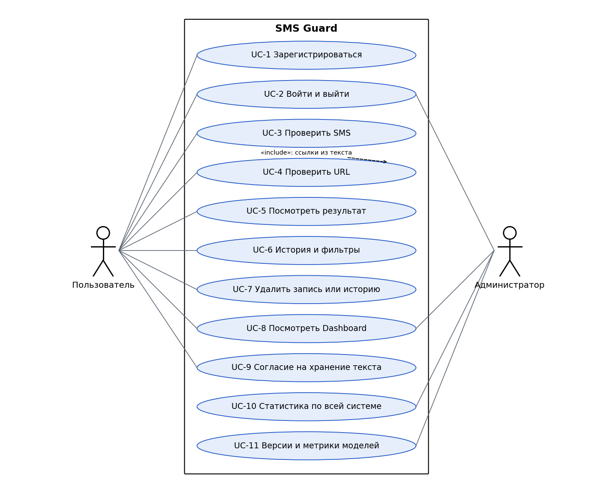

# Задание 1. Анализ предметной области и проектирование

## 1. Проблема

Смишинг — это фишинг через SMS: злоумышленник выдаёт себя за банк, службу доставки,
госорган или родственника и пытается получить деньги либо данные. Типовая атака сочетает
**текст с психологическим давлением** и **ссылку на поддельный сайт**, поэтому анализировать
что-то одно недостаточно. Обычному пользователю сложно быстро оценить структуру адреса
(поддомены, маскировка, сокращатели), а правила операторов не успевают за новыми шаблонами.

SMS Guard принимает SMS или ссылку, оценивает их двумя ML-моделями и словарём правил,
рассчитывает Risk Score и объясняет результат. Система носит рекомендательный характер:
она оценивает вероятность угрозы, но не гарантирует безопасность.

## 2. Категории угроз

Все примеры искусственные; ссылки используют только зарезервированные домены.

| № | Категория | Пример SMS | Признаки социальной инженерии |
|---|---|---|---|
| 1 | Поддельный банк | «Служба безопасности банка: с вашего счёта пытаются списать 120 000 тг. Назовите код из SMS оператору.» | авторитет, страх, срочность |
| 2 | «Блокировка карты» | «Ваша карта заблокирована! Срочно подтвердите данные по ссылке: http://secure-bank-verify.example/login» | страх, срочность |
| 3 | Выигрыш или приз | «Поздравляем! Вы выиграли iPhone. Получите приз по ссылке http://prize-win.example» | выгода, срочность |
| 4 | Служба доставки | «Ваша посылка ожидает оплаты таможенного сбора 350 ₸: http://post-delivery-pay.example» | авторитет, незначительность суммы |
| 5 | «Родственник в беде» | «Мама, у меня проблемы, срочно переведи 50 000 на этот номер, потом всё объясню. Никому не говори.» | страх, срочность, секретность |
| 6 | Запрос кода из SMS | «Оператор связи: ваш номер отключат. Продиктуйте код из смс для продления договора.» | авторитет, страх |
| 7 | Поддельные госуслуги и штрафы | «Госуслуги: у вас неоплаченный штраф 25 000 тг. Оплатите срочно: http://egov-fine.example» | авторитет, страх, срочность |
| 8 | Инвестиционное мошенничество | «Гарантированный доход 20% в день. Осталось всего 5 мест: http://crypto-income.test» | выгода, срочность |

### Как признаки связаны с системой

| Приём давления | Группа словаря (`ml/rules.py`) |
|---|---|
| Срочность | `URGENCY` |
| Страх | `ACCOUNT_BLOCK` |
| Авторитет | `AUTHORITY`, `BANK_CARD` |
| Выгода | `PRIZE` |
| Секретность | `SECRECY` |
| Прямое действие | `MONEY_TRANSFER`, `CODE_REQUEST` |

## 3. Анализ аналогов

| Решение | Назначение | Сильные стороны | Ограничения |
|---|---|---|---|
| Встроенные фильтры спама смартфонов | Автоматически скрывают нежелательные SMS | Работают без действий пользователя, часть анализа выполняется на устройстве | Не объясняют решение, нет отдельной оценки ссылки, слабее на редких языках |
| Google Safe Browsing | Проверка URL по спискам опасных сайтов | Большая база, встроен в браузеры, есть API | Новая ссылка может ещё не попасть в списки, текст сообщения не анализируется |
| VirusTotal | Проверка URL и файлов множеством антивирусных движков | Много независимых источников, подробный отчёт | Отчёт сложен для обычного пользователя, текст SMS не анализируется |
| Антиспам операторов связи | Фильтрация рассылок на уровне сети | Блокирует массовые рассылки до получателя | Закрытые правила, нет объяснения пользователю, новые шаблоны проходят |

**Вывод.** Аналоги решают либо задачу с текстом, либо задачу со ссылкой и редко объясняют
результат. SMS Guard объединяет оба анализа, показывает причины и рекомендацию. Ограничение
проекта: обучающие данные англоязычные, поэтому для русского и казахского языков ML-оценка
текста отмечается как ненадёжная.

## 4. Целевая аудитория и роли

**Аудитория:** обычные пользователи телефонов, особенно те, кому сложно самостоятельно оценить
подозрительное сообщение, а также сотрудники, проверяющие сообщения от клиентов.

| Роль | Возможности |
|---|---|
| Пользователь | Регистрация и вход, проверка SMS и URL, просмотр результата, своя история и статистика, профиль |
| Администратор | Всё, что есть у пользователя, плюс агрегированная статистика по всем пользователям (без текстов чужих SMS) и версии моделей |

## 5. Диаграмма вариантов использования

Исходник: `docs/diagrams/use_case.puml`.

| № | Прецедент | Роль |
|---|---|---|
| UC-1 | Зарегистрироваться | Пользователь |
| UC-2 | Войти и выйти | Пользователь, Администратор |
| UC-3 | Проверить SMS | Пользователь |
| UC-4 | Проверить URL | Пользователь |
| UC-5 | Посмотреть подробный результат | Пользователь |
| UC-6 | Просмотреть и отфильтровать историю | Пользователь |
| UC-7 | Удалить запись или всю историю | Пользователь |
| UC-8 | Посмотреть Dashboard | Пользователь, Администратор |
| UC-9 | Управлять согласием на хранение текста | Пользователь |
| UC-10 | Посмотреть статистику по всей системе | Администратор |
| UC-11 | Посмотреть версии и метрики моделей | Администратор |

## 6. Таблица требований

Приоритет по MoSCoW: **M** — Must, **S** — Should, **C** — Could.
Статус показывает состояние на этапе прототипа (7 ноября).

### Функциональные требования

| Код | Требование | Приоритет | Статус |
|---|---|---|---|
| ФТ-1.1 | Регистрация с проверкой логина, e-mail и пароля | M | Прототип |
| ФТ-1.2 | Уникальность логина и e-mail | M | Прототип |
| ФТ-1.3 | Вход; пауза 60 с после 5 неудачных попыток | M | Прототип |
| ФТ-1.4 | Пароли только как хеш с солью | M | Прототип |
| ФТ-1.5 | Выход уничтожает сессию | M | Прототип |
| ФТ-1.6 | Страницы доступны только после входа | M | Прототип |
| ФТ-1.7 | Пользователь видит только свои проверки | M | Прототип |
| ФТ-1.8 | Защита cookie и CSRF | M | Прототип |
| ФТ-1.9 | Агрегированная статистика администратора | S | Частично |
| ФТ-2.1 | Поле SMS от 1 до 1000 символов | M | Прототип |
| ФТ-2.2 | Определение языка (ru, kk, en, other) | M | Прототип |
| ФТ-2.3 | Очистка и нормализация текста | M | Готово |
| ФТ-2.4 | Единый сохранённый pipeline TF-IDF | M | Готово |
| ФТ-2.5 | Словарь правил, не менее 6 групп | M | Прототип |
| ФТ-2.6 | ML-вероятность P_sms | M | Готово (baseline) |
| ФТ-2.7 | Передача до 3 ссылок в проверку URL | M | Прототип |
| ФТ-2.8 | Предупреждение о сниженной надёжности для языка | M | Прототип |
| ФТ-3.1 | Проверка формата URL, длина до 2048 | M | Прототип |
| ФТ-3.2 | Не менее 20 числовых признаков URL | M | Прототип |
| ФТ-3.3 | Обнаружение IP-адреса | M | Прототип |
| ФТ-3.4 | Подсчёт поддоменов, точек, дефисов, цифр, спецсимволов | M | Прототип |
| ФТ-3.5 | HTTPS, порт, символ @, двойной // | M | Прототип |
| ФТ-3.6 | Список сокращателей, не менее 15 сервисов | M | Прототип |
| ФТ-3.7 | Подозрительные ключевые слова | M | Прототип |
| ФТ-3.8 | Punycode, смешение алфавитов, сходство с брендом | S | Прототип |
| ФТ-3.9 | ML-классификация URL, P_url | M | Этап 2 (сейчас правила) |
| ФТ-3.10 | Ссылки некликабельны, домен выделен | M | Прототип |
| ФТ-3.11 | Внешний сервис репутации | C | Не планируется |
| ФТ-4 | Сравнение алгоритмов и сохранение моделей (раздел 2.4) | M | Этап 2 |
| ФТ-5 | Risk Score, причины, рекомендация (раздел 2.5) | M | Прототип, калибровка на этапе 2 |
| ФТ-6 | Dashboard (раздел 2.6) | M | Прототип |
| ФТ-7 | История с фильтрами и пагинацией (раздел 2.7) | M | Прототип |
| ФТ-7.1 | Экспорт истории в CSV | C | Не начато |

### Нефункциональные требования

| Код | Требование | Приоритет | Статус |
|---|---|---|---|
| НФТ-1 | Анализ SMS не более 500 мс | M | Замер на этапе 3 |
| НФТ-2 | Dashboard при 1000 записях не более 2 с | S | Замер на этапе 3 |
| НФТ-3 | Двойной клик не создаёт дубликат | S | Кнопка блокируется, проверка на сервере на этапе 3 |
| НФТ-4 | Только ORM, без конкатенации SQL | M | Прототип |
| НФТ-5 | Экранирование ввода, защита от XSS | M | Прототип |
| НФТ-6 | Не более 30 проверок в минуту (ответ 429) | M | Прототип |
| НФТ-7 | Секреты в `.env`, `DEBUG=False` в демо | M | Прототип |
| НФТ-8 | Ограничения на загрузку файлов | C | Загрузка не реализуется |
| НФТ-9 | Тексты SMS не пишутся в логи | M | Прототип |
| НФТ-10 | Адаптивность при 360, 768, 1366 px | M | Прототип |
| НФТ-11 | Ошибки на русском рядом с полем | M | Прототип |
| НФТ-12 | Некорректный ввод не вызывает ошибку 500 | M | Прототип |
| НФТ-13 | Лог `logs/app.log` с ротацией | M | Готово |
| НФТ-14 | Понятное поведение без файла модели | M | Прототип |
| НФТ-15 | Покрытие `ml/` и `risk/` тестами не менее 60% | S | Этап 3 |
